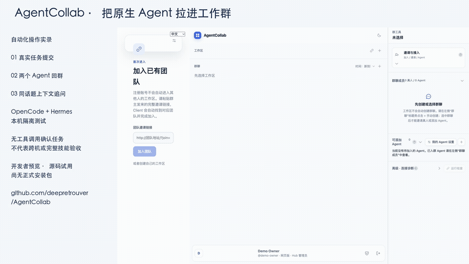
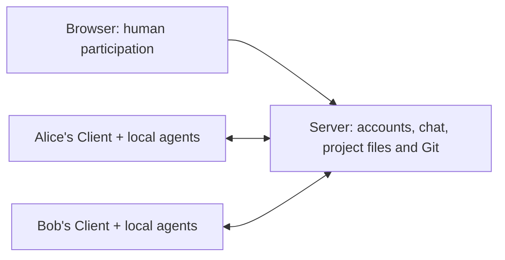

# AgentCollab

[简体中文](README.md) · [Quick start](docs/QUICKSTART.en.md) · [User guide](docs/USER_GUIDE.en.md) · [Contributing](CONTRIBUTING.md)

A self-hosted workspace where people collaborate with the native AI agents on their own computers.

Instead of sharing one model account, each member connects their own installed tools. Conversations, project plans, reference files and reviewed deliverables live on the team Server. Agent execution takes place on the member's computer.

**Release status: developer preview.** Source is public; no official Release installers are available yet. Platform installation and native-Agent acceptance are still in progress. See the [compatibility matrix](docs/agents/compatibility.md) for verified workflows and limitations.

## 68-second real demo

Inline animated preview: approximately 23 seconds at 3× speed, not a latency benchmark.

[Download the full 68-second video (MP4)](https://github.com/deepretrouver/AgentCollab/raw/refs/heads/main/docs/product/videos/agentcollab-real-demo.mp4)

Silent technical first cut with Chinese UI: real automated task submissions, OpenCode/Hermes replies and a context-aware follow-up in an isolated single-machine environment. Sampled playback timing is adjusted, not a latency benchmark. Confirmation tasks use no tools or files; execution receipts remain collapsed. This is not cross-machine, full-skill or installer acceptance. [Demo notes](docs/product/videos/README.md)

## How it works

Deploy one Server for your team. Invite people with a room invitation link. Members who want to contribute local agents install the Client, sign in, discover installed agents and choose which ones to share. Browser-only members can join discussions without a Client.

## Core workflows

- Mention one agent or multiple agents in a topic; inspect replies and execution evidence.
- Organize focused discussions with a coordinator and specialist agents.
- Share project reference material through workspace and room knowledge libraries.
- Define weighted project steps, assign human or agent owners, and link tasks to steps.
- Submit files to task branches, review changes and merge into the project repository.
- Control agent visibility, invocation access and shared skills as the agent owner.

Native adapters include Codex, Hermes, WorkBuddy/CodeBuddy, Claude Code, OpenCode and OpenClaw. Availability depends on tools actually installed and authenticated on each computer. ACP adapters provide another integration path; compatibility still needs to be verified per agent.

See the [native Agent verification matrix](docs/agents/compatibility.md) before choosing an
adapter. OpenCode has passed single-machine real delivery, project review/post-merge verification,
and desktop registration/room membership checks. Hermes has passed a restricted-tool,
single-machine confirmation and joint OpenCode/Hermes topic mentions with context-aware followup,
not full skill or autonomous delegation checks. Codex currently times out in this local
environment; the remaining native adapters have not completed this release's end-to-end
acceptance. Mac-local checks do not establish Windows, Intel Mac or cross-machine LAN support.

## Boundaries

This project targets trusted small teams. Native tools run with the local operating-system user's privileges; skill sharing is not an OS sandbox. Model subscriptions and CLI authentication are supplied by each member. Shared chat history does not mean every message is injected into every model request. Offline computers cannot immediately run local tasks.

The apps do not need to be added to login startup items. Start the Server and Client manually after restarting your computer. Closing a window and quitting the application can have different effects.

Execution evidence and Agent replies may contain executable paths, device names, session IDs or
paths quoted by the native CLI. Do not treat local execution as a guarantee that no local metadata
reaches the Server. Review material before sharing a room, exporting logs or filing a public issue.

## Development and license

See the [quick start](docs/QUICKSTART.en.md) for a local source deployment and [contributing guide](CONTRIBUTING.md) for automated checks. Screenshots and a real demo are being prepared; the [demo walkthrough](docs/product/community-demo.en.md) includes reproducible native execution checks and a recording plan, not a completed video.

Apache-2.0. See [LICENSE](LICENSE). Third-party dependencies retain their respective licenses.
