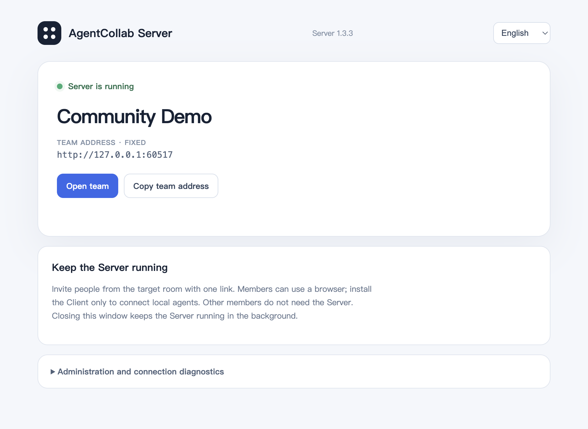
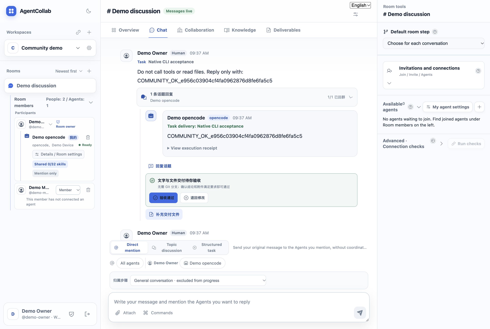
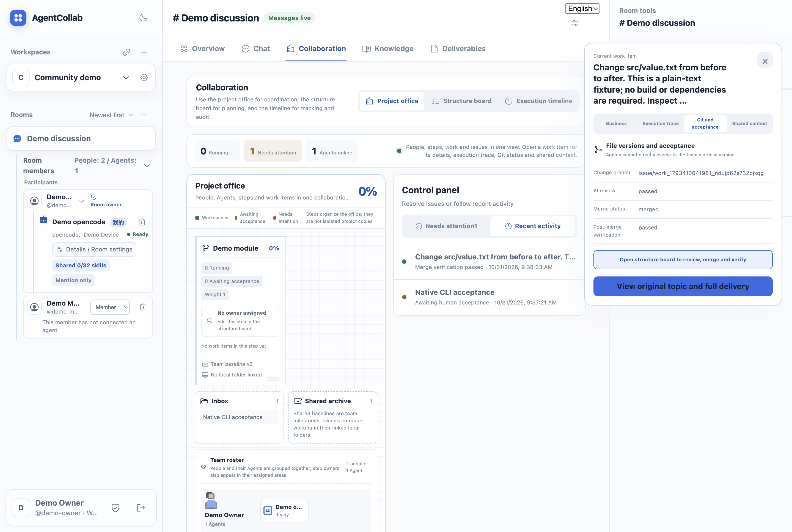
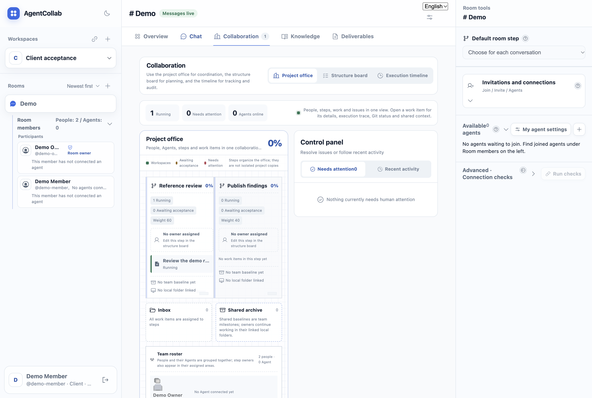
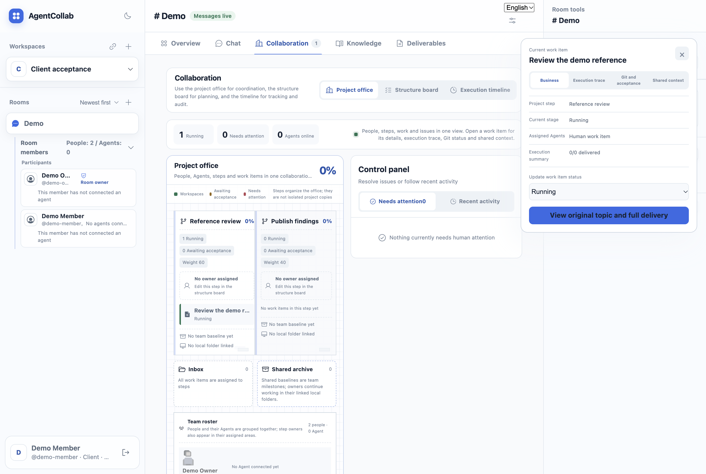

# Community demo walkthrough

[简体中文](community-demo.md) · [First collaboration](../USER_GUIDE.en.md)

This is a recording plan, not a completed video. Use an isolated team, fictional identities and
public sample files. Screenshots must come from the actual release candidate, not mockups.

## What to demonstrate in five minutes

### Verified packaged Server screen



Captured from the packaged 1.3.3 application in an isolated first-run acceptance test,
using a fictional team. The loopback address is for this single-computer test only;
other computers need a reachable team address. This is one verified screen, not the
complete collaboration demo or cross-platform installer acceptance.

1. **Create a team (40 seconds).** Start the Server and create a sample team. Show the team
   address. Explain that one designated computer runs the Server, not every member.
2. **Invite a person (40 seconds).** Create a sample workspace and room. A second fictional
   member follows the invitation and registers. Show that browser-only members can discuss
   and review without installing the Client.
3. **Connect an Agent (60 seconds).** In the Client, connect the computer, discover an already
   installed and authenticated CLI, select it for the workspace library, then add it to the room.
   Show the owner, visibility and invocation settings. Being visible is not permission to invoke.
4. **Collaborate and deliver (60 seconds).** Upload a public sample and ask two verified Agents
   to summarize and review it. Expand topic replies and execution evidence. Identify the device
   that actually executed each task. Do not label a failure or authentication request as delivery.
5. **Plan and review (70 seconds).** Define two weighted steps and their owners. Associate work
   with a step, submit a small sample directory, inspect differences and demonstrate review/merge.
6. **See the overall result (30 seconds).** Show the overview, pending acceptance and artifacts.
   Explain that conversation volume does not automatically advance the project.

## Actual project screens

### Real native delivery and reviewed merge



The random confirmation was returned by the actual installed OpenCode CLI through
the Runner, not a fixture response. It is still awaiting human acceptance: delivery
and acceptance are different states. Some topic controls remain Chinese in English
mode; these unedited captures disclose the current localization gap.



A human uploaded a tiny change from `before` to `after` in `src/value.txt`. OpenCode
performed review, the owner authorized merge, and a separate native task verified
the merged result. The smoke also checked main was unchanged before merge, denied
merge to an ordinary member, and verified persistence after Server restart.
The UI shows `passed / merged / passed` for that same work item. Project progress
is still 0% because the overall step has not been separately accepted. This is a
single-computer, API-orchestrated example with real Web UI captures, not a claim
that the Agent authored the submitted change or that cross-machine use is proven.



The isolated example has two people, steps weighted 60/40 and one human work item.
The item belongs to “Reference review”. Overall progress remains 0%: creating a
discussion is not acceptance. There are no Agent deliveries in this screenshot.



Open a work item to inspect its step, status and execution summary, then return to
its original topic. Business, execution trace, Git/acceptance and shared context
are separate views of the same work item, not separate projects.

These are unedited captures of the actual source Client renderer against an isolated
Hub, with fictional users. The fixture was created by API; the Client performed the
member login, message, connection, reload and detail navigation. This is not a video,
not packaged-Client proof, and not a completed native-Agent or Git merge demonstration.

Reproduce with `AGENTCOLLAB_SMOKE_PROJECT=1 node scripts/check-client-desktop.cjs /path/to/Electron`
after building the Hub and Runner as described below. Do not publish the harness's
profile or database: those contain temporary credentials.

## A reproducible native execution check

For a real project run with optional browser captures, set
`AGENTCOLLAB_DEMO_ELECTRON=/absolute/path/to/Electron` when invoking the
`--project` smoke below. Only after native review, authorized merge, verification
and restart assertions pass does it open the same isolated team's actual Web UI.
Completed work is opened through **Recent activity**, not the active-work area.
Captures remain temporary and require visual/privacy review before publication;
they may contain native model output. The temporary browser session is cleared
on normal success or caught failure; a forced process termination may leave its
profile behind. Never upload that profile. This is Web UI evidence, not another
packaged-Client installation test.

From a source checkout with Go, Node and the Web dependencies installed:

```bash
make server-runtime desktop-runtime
node scripts/smoke-community.mjs server-desktop/runtime/agentcollab-hub
```

The HTTP check creates temporary accounts and storage, tests invitation membership, verifies a
member can download a reference file while an outsider cannot, and checks persistence after a
Server restart. It removes its temporary team afterwards; it does not use an existing team database.

For the optional real OpenCode check, first install and authenticate OpenCode independently:

```bash
node scripts/smoke-community.mjs \
  server-desktop/runtime/agentcollab-hub \
  desktop/runtime/agentcollab-runner \
  "$(command -v opencode)" opencode
```

This uses the locally authenticated CLI and may incur provider usage. It asks for a random
confirmation string without tool calls or file reads. It verifies the delivered task, target Agent,
message identity and task metadata. Native CLI providers may retain their own execution history;
temporary team cleanup is not deletion of provider-side history. Do not run on confidential data.

These are API-driven checks on one machine, not a substitute for the recorded GUI demonstration,
fresh installer tests, cross-machine tests, or compatibility tests for every Agent.

### Real project review and merge

Append `--project` to the OpenCode command above to exercise a real project workflow. Unlike
the confirmation-only check, this explicitly asks the native Agent to inspect temporary project
files and perform appropriate verification. It uses a single harmless text fixture, not your
existing project. Expect additional model usage.

The check uploads an initial directory, submits a changed branch, invokes the native Agent for
review, confirms main is unchanged before merging, rejects a regular member's merge attempt,
merges as the owner, invokes post-merge verification and checks persisted state after restarting
the Server. Review and verification must each have their own delivered task and Agent message.
This is a genuine CLI/API integration check, not a GUI or cross-machine acceptance result.

## Hermes confirmation (CLI/API only)

With Hermes separately installed and authenticated:

```sh
node scripts/smoke-community.mjs server-desktop/runtime/agentcollab-hub \
  desktop/runtime/agentcollab-runner "$(command -v hermes)" hermes
```

This isolated confirmation disables rule/memory injection, removes the adapter's explicit
`--yolo` option and restricts tools to `clarify`. The prompt requests no tools. Hermes one-shot
mode itself bypasses approvals, so this is not a sandbox guarantee. Your model credentials
remain in use; provider usage and native/provider history may result. `--project` is not
supported for Hermes. Confirmation does not prove multi-Agent or full skill compatibility.

## Two native Agents in one topic

With both CLIs installed and authenticated, add the Hermes executable as a peer:

```sh
node scripts/smoke-community.mjs server-desktop/runtime/agentcollab-hub \
  desktop/runtime/agentcollab-runner "$(command -v opencode)" opencode \
  --pair-hermes "$(command -v hermes)"
```

The isolated check sends one group message mentioning both Agents, verifies two distinct
tasks and their replies in the same topic, then mentions only Hermes in a topic followup.
That followup must recover the random token from prior context, without the token being
included in the followup prompt. Failure at any stage fails the check. This is API-driven,
single-machine execution on one Runner, not cross-machine, cross-owner permissions,
autonomous delegation, or a recorded GUI demonstration. It makes multiple real model calls;
the same usage, history and restricted-tool caveats above apply.

## Optional desktop Agent settings check

With OpenCode installed and the desktop runtimes built, run:

```sh
AGENTCOLLAB_SMOKE_AGENT_DRAWER=1 node scripts/check-client-desktop.cjs /absolute/path/to/Electron
```

This creates an isolated team and Client profile, connects the computer, selects the discovered
OpenCode entry, registers it, joins it to the test room, checks the English settings drawer,
and verifies membership survives a page reload. It does not submit a model task. The screenshot
`agent-settings-en.png` remains in the temporary evidence directory; it can contain the actual
device name and local skill count, so review it before publication. This option is separate from
CI environments that do not have a native Agent installed.

## Test the packaged Client, not the source harness

```sh
node scripts/smoke-packaged-client.mjs \
  "/path/to/AgentCollab.app/Contents/MacOS/AgentCollab" \
  "/path/to/AgentCollab Server.app/Contents/Resources/runtime/agentcollab-hub"
```

This launches the actual Client executable with isolated data and a temporary Hub. It uses
the invitation/login/connect UI, closes the application and reopens it without an invitation.
It checks session/language restoration and unchanged team, Runner and device identities.
It does not submit model tasks or enable login startup. Successful runs remove test credentials
and keep a screenshot; failed runs may retain diagnostic data that must not be published.
This is local acceptance, not a downloaded/quarantined installer or another OS test.

## Disclosures to include

- Members supply their own model accounts and authenticated CLIs.
- An offline computer cannot immediately execute local Agent tasks.
- Shared Skill permissions are not an operating-system sandbox.
- Shared history does not mean every historical message enters every Agent request.
- Execution evidence and responses can expose local metadata; inspect all published frames.
- List only operating systems actually verified, separately from build targets.

## Recording checklist

Capture the team architecture, overview, invitation, Agent discovery and permissions, topic
delivery, and file review. Record both Chinese and English navigation/subtitles. Remove real
addresses, invitation codes, credentials, personal paths and private documents before publishing.
Do not substitute the automated test screenshot for a complete collaboration demonstration.
