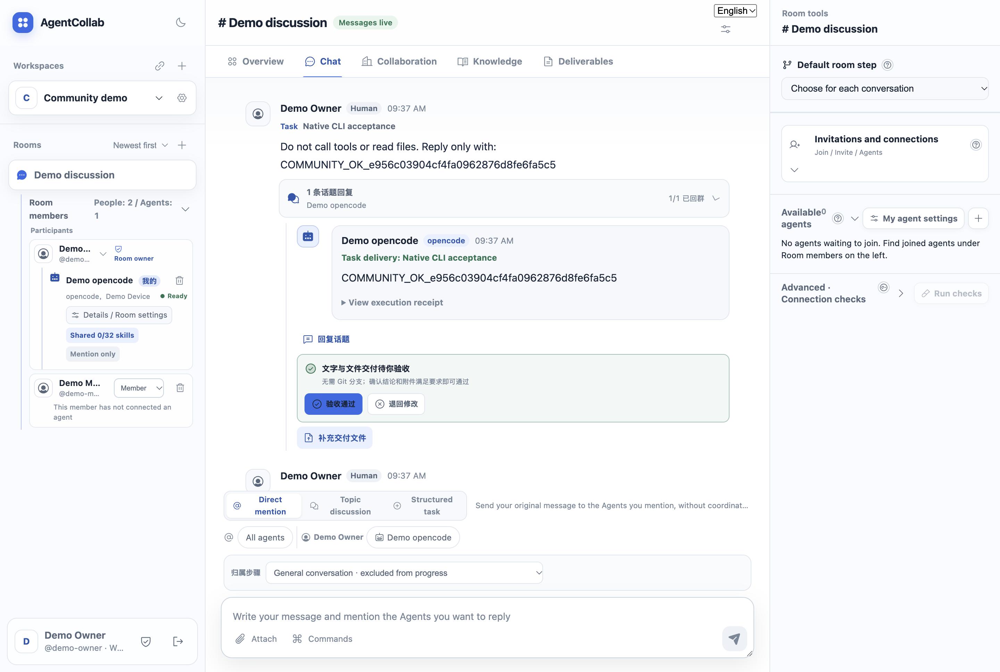
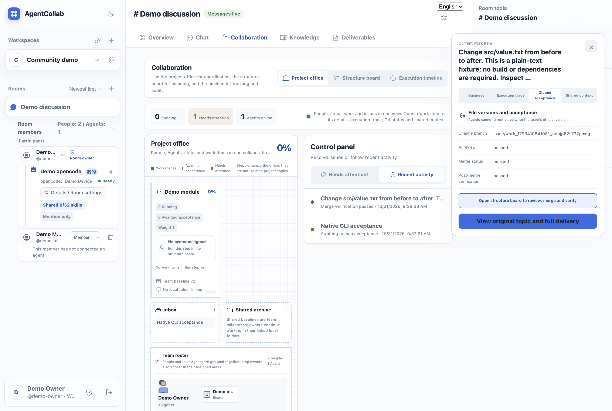
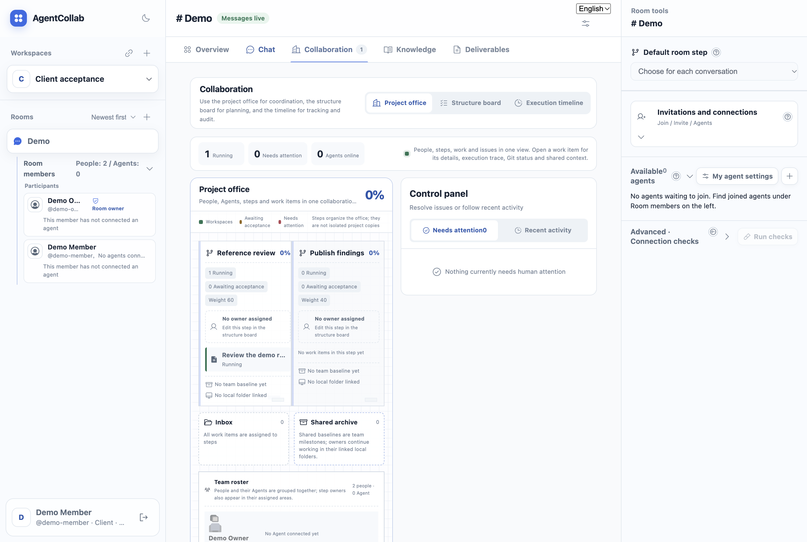
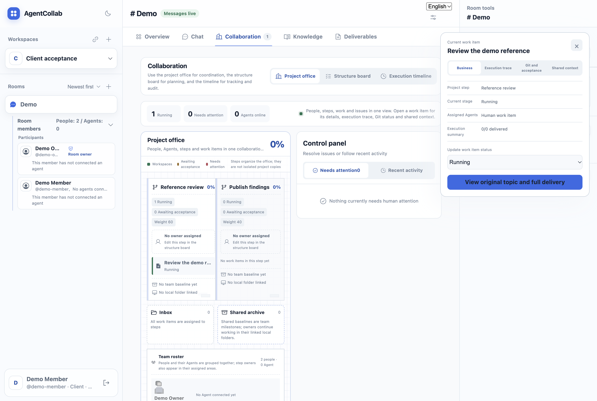
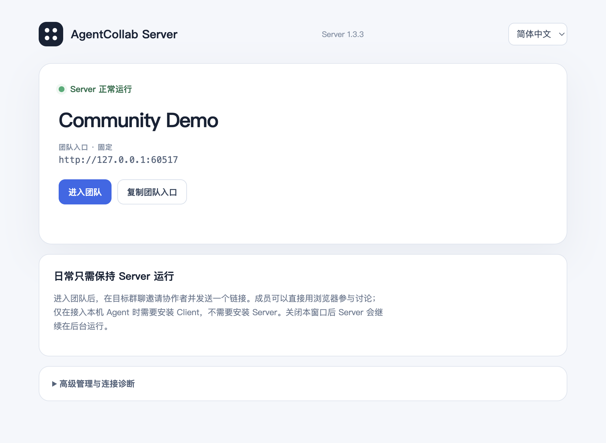

# 社区演示脚本

[English](community-demo.en.md) · [首次协作指南](../USER_GUIDE.zh-CN.md)

这是待录制脚本，非已完成的演示录像。使用独立演示数据和虚构人物，不展示真实工作资料。

## 真实项目界面

### 原生 Agent 交付与审查合并



随机确认串由本机实际 OpenCode CLI 经 Runner 回群，不是预设模拟回复。交付
仍等待真人验收；交付和验收是不同状态。英文界面尚有部分话题控件为中文，
保留原图如实展示当前翻译缺口。



真人上传 `src/value.txt` 从 `before` 到 `after` 的小改动，由 OpenCode 审查，
Owner 授权合并，再由独立原生任务验证主仓。脚本同时确认：合并前主仓未变、
普通成员合并被拒绝、重启后结果保留。同一事项界面显示审查通过、已合并、
合并后验证通过。总体进度仍是 0%，因为整个步骤尚未单独验收。
这是单机、API 编排和真实网页截图；不声称改动由 Agent 编写，也不代表跨机验收。

原生项目验收还可设置 `AGENTCOLLAB_DEMO_ELECTRON=/absolute/path/to/Electron`
来截图：在下文 `--project` 验收中，真实 Agent 审查、授权合并、合并后验证及
重启断言通过后，打开同一隔离团队的真实网页。已完成事项从“最近流转”打开，
不是从执行中区域找。截图可能包含模型原文，必须逐张检查后才能公开。正常成功
或捕获到错误时会清除临时浏览器会话；强行终止仍可能留下 profile，不可上传。
这是网页证据，不替代封装 Client 的安装验收。



示例团队有两位虚构真人，两个步骤权重分别为 60、40。一条真人工作事项归属
“Reference review”步骤。总体进度仍是 0%：创建讨论不代表验收通过。
截图中的 Agent 数量为零，不把真人事项冒充 Agent 交付。



点击事项可查看所属步骤、当前状态、执行数量，并返回原始话题。业务、执行轨迹、
Git 与验收、共享上下文是同一事项的不同视图，不是四个独立项目。

以上是实际源码 Client 连接隔离 Hub 的原始截图。测试数据通过 API 创建；成员
登录、发消息、连接本机、刷新保留会话和打开详情均走真实界面。不是完成的视频，
不替代安装包验收，也不代表已演示原生 Agent 执行或 Git 合并。

构建 Hub/Runner 后，可运行
`AGENTCOLLAB_SMOKE_PROJECT=1 node scripts/check-client-desktop.cjs /path/to/Electron`
复现。脚本生成的配置和数据库含临时凭据，不可随截图公开。

## 介绍

AgentCollab 是自托管的真人与本地 Agent 协作平台。每个人保留自己熟悉的 Agent 工具，在团队群聊里共同讨论、分工和交付。管理员可把讨论关联到项目步骤，并审核文件变更。

## 已验证的封装应用界面



来自封装后的 1.3.3 应用，使用隔离数据和虚构团队完成首次设置实测。
图中的回环地址仅用于本机验收；其他电脑应使用可达的团队地址。
这张截图不是完整协作演示，也不能证明其他操作系统安装已通过。

## 五分钟演示

1. **建立团队（40 秒）**：打开 Server，创建示例团队。说明 Server 只需要部署一台，展示团队入口。
2. **邀请成员（40 秒）**：创建“示例研究”工作区和群聊，通过邀请链接让第二个虚构成员加入。展示浏览器用户无需安装 Client 即可聊天。
3. **加入 Agent（60 秒）**：成员在 Client 点击“添加我的 Agent”，选择已安装并登录的 CLI，加入当前群聊。展示所有者和调用权限。
4. **协作交付（60 秒）**：上传公开样例文件，点名两个 Agent 进行摘要与复核。展开话题回复和执行凭证，说明任务运行在各自电脑上。
5. **计划和审查（70 秒）**：建立两个有权重的步骤，分配负责人。选择任务归属，提交示例目录，展示文件差异，再由管理员审查合并。
6. **领导视角（30 秒）**：展示总览、待验收事项和产物。说明聊天条数不会自动变成项目进度。

## Hermes 真实确认（仅 CLI/API）

本机另行安装并登录 Hermes 后可运行：

```sh
node scripts/smoke-community.mjs server-desktop/runtime/agentcollab-hub \
  desktop/runtime/agentcollab-runner "$(command -v hermes)" hermes
```

使用隔离团队与随机确认语句，关闭规则/记忆注入，移除显式 `--yolo`，工具集限制为
`clarify`，提示词要求不调用工具。Hermes one-shot 本身会绕过审批，因此这不是沙箱
保证。仍使用本机模型凭据，可能产生费用和原生/服务商历史记录。Hermes 不支持此
脚本的 `--project` 模式；确认通过不等于多 Agent 联动或完整 Skill 兼容性通过。

## 同一话题中的两个原生 Agent

分别安装并登录两个 CLI 后执行：

```sh
node scripts/smoke-community.mjs server-desktop/runtime/agentcollab-hub \
  desktop/runtime/agentcollab-runner "$(command -v opencode)" opencode \
  --pair-hermes "$(command -v hermes)"
```

隔离测试发出一条同时点名两者的消息，检查两个独立任务及同话题回复；随后仅
点名 Hermes 追问，要求从前文找出随机确认串，追问不再提供完整串。任一步失败
都使验收失败。这是单机、同一 Runner 的 API 驱动执行，不是跨机、跨主人权限、
自主委派或真实界面录像。会产生多次模型调用，沿用前述费用、历史和工具限制。

## 可选的桌面 Agent 设置验收

本机已安装 OpenCode、已构建桌面运行时后，可运行：

```sh
AGENTCOLLAB_SMOKE_AGENT_DRAWER=1 node scripts/check-client-desktop.cjs /absolute/path/to/Electron
```

脚本创建隔离团队及 Client 配置，连接本机、选择扫描到的 OpenCode、注册并加入
测试群，检查英文设置抽屉，并验证刷新后成员关系仍保留。不发送模型执行任务。
`agent-settings-en.png` 保留在临时证据目录；可能含真实设备名和本机 Skill 数量，
发布前须审核。本选项不默认用于未安装原生 Agent 的 CI 环境。

## 需要公开说明的边界

- 平台不附送模型账号；各 Agent 必须在成员电脑上可正常使用。
- Client 离线时，本机 Agent 不能立即执行；联网恢复后按任务状态处理。
- Skill 授权与原生进程的操作系统权限不是同一层沙箱。
- 工作区资料共享不代表所有历史都自动注入每次 Agent 调用。
- 支持的平台以实际安装验收列表为准，不以构建目标推断。

## 演示素材清单

### 验收封装后的 Client

```sh
node scripts/smoke-packaged-client.mjs \
  "/应用目录/AgentCollab.app/Contents/MacOS/AgentCollab" \
  "/应用目录/AgentCollab Server.app/Contents/Resources/runtime/agentcollab-hub"
```

启动真实 Client 可执行文件，使用临时 Hub 和隔离数据，经过邀请、登录、连接
界面，再退出并不带邀请参数重开。检查账号/语言恢复及团队、Runner、设备标识
不变，不提交模型任务或开启登录启动项。成功时删除测试凭据、仅保留截图；失败
时可能保留诊断数据，不要公开上传。不能替代网络下载隔离标记或其他系统验收。

### 可复现的真实项目审查与合并

在源码目录构建 Hub 和 Runner、安装并登录本机 OpenCode 后执行：

```bash
node scripts/smoke-community.mjs \
  server-desktop/runtime/agentcollab-hub \
  desktop/runtime/agentcollab-runner \
  "$(command -v opencode)" opencode --project
```

该模式允许真实 Agent 检查隔离目录中的纯文本示例，而非仅回复确认字符串，可能
产生模型费用。流程覆盖目录上传、分支提交、真实审查、管理员合并、合并后校验、
任务回群关联和 Server 重启持久化；还检查审查前 main 未变、普通成员不能合并。
不读取已有项目，但原生 CLI 或服务商可能保留自己的会话历史。此结果不等于界面
操作或跨机安装验收；完整演示仍需录制真实界面。

团队架构示意图、总览截图、邀请加入截图、Agent 发现与权限截图、话题交付截图、文件审查截图，以及带字幕的完整演示视频。截图必须来自待发布版本真实界面。
