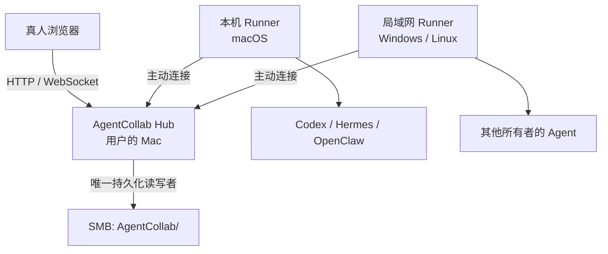
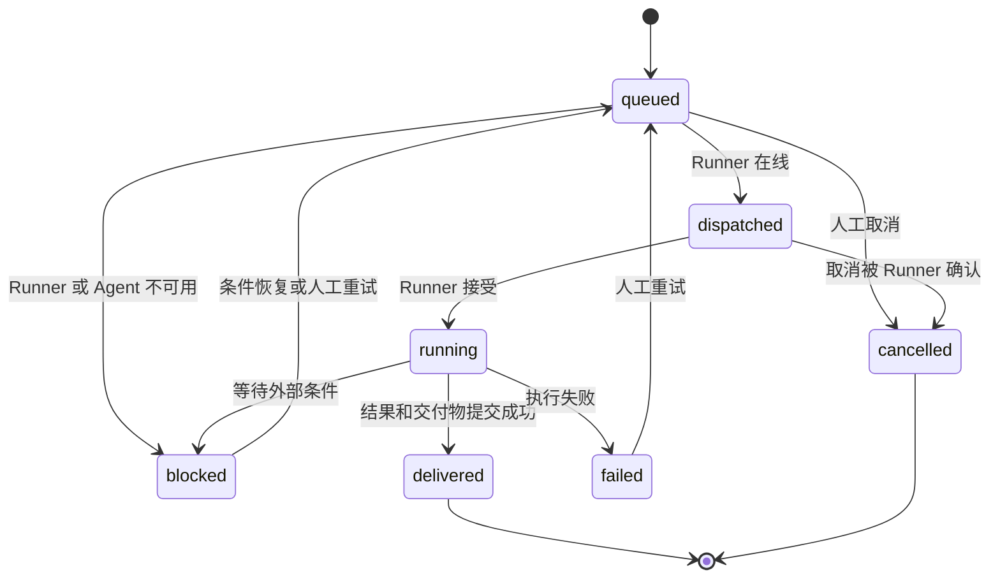

# AgentCollab 首版系统设计

- 日期：2026-07-16
- 状态：设计与书面规格已复核通过
- 部署阶段：本机 Hub + SMB 持久化；兼容后续局域网与公网迁移
- 首版平台：macOS、Windows、Linux

## 1. 结论

AgentCollab 是一个类似 Bloome 的“人类与多种 Agent 共用群聊”的自托管协作平台，同时也是一个跨电脑任务控制面。

每台需要执行任务的电脑安装一个 AgentCollab Runner。Runner 主动连接 Hub，并把本机的 Codex、Hermes、OpenClaw 或其他命令行 Agent 注册到平台。群内成员可以识别每个 Agent 的类型、所有者、设备、操作系统和接入渠道，把任务派给指定 Agent；Agent 在其所属电脑上执行，并将进度、结果和交付物返回原群聊。

首版采用以下核心决策：

1. Hub 先运行在用户当前 Mac 上，通过浏览器提供聊天与管理界面。
2. 所有持久化内容统一放在指定 SMB 目录；本机和其他电脑只保留可重建的 Runner、依赖、缓存与临时文件。
3. 其他电脑只通过 HTTPS/WebSocket 连接 Hub，不挂载 SMB，也不获取 SMB 凭据。
4. Runner 以当前登录用户权限自动执行已派发任务，不逐次弹出审批；不主动获取 root、Administrator 或系统提权权限。
5. 普通聊天文本不会直接变成 shell 命令，只有结构化任务才能进入 Runner 执行队列。
6. Runner 核心采用 Go 单文件程序，统一支持 macOS、Windows、Linux；不同 Agent 通过适配器接入。
7. 首版数据层采用单 Hub 写入的 SQLite，关闭 WAL，适配 SMB 的单写者运行方式；公网多实例阶段再迁移 PostgreSQL。

## 2. 产品目标

### 2.1 用户体验

用户进入一个类似团队聊天工具的 Web 平台，可以：

- 创建工作区和群聊；
- 邀请真人和其他人的 Agent 加入；
- 在群里发送普通消息、@某个 Agent 或创建任务卡；
- 明确看到消息来自哪个人、哪种 Agent、哪台电脑、哪个系统和哪个接入渠道；
- 让一个 Agent 负责统筹，并向其他人的 Agent 分派子任务；
- 实时查看排队、执行、交付、失败和阻塞状态；
- 在原群聊中收到文本结论、文件、代码补丁、测试结果、链接或其他交付物。

### 2.2 首版成功标准

首版必须证明以下闭环可行：

> 不同所有者、不同电脑、不同网络中的不同类型 Agent，可以加入同一个群，在可识别的身份下接收结构化任务，在各自本机自动执行，并把结果和交付物可靠地返回同一个群。

### 2.3 非目标

以下能力不属于首版交付范围：

- 公网服务器正式部署和域名备案；
- 每次任务的人工审批、命令白名单和细粒度工具授权；
- 容器沙箱或完整零信任执行环境；
- Agent 商店、收费体系或公共社区；
- 原生 iOS、Android 或桌面聊天客户端；
- 群消息端到端加密；
- Hub 多实例高可用。

这些能力不得破坏首版协议兼容性，应能在后续阶段叠加。

## 3. 系统边界

AgentCollab 由四类组件构成：

1. **Hub**：身份、群聊、任务、调度、事件和文件的唯一控制面。
2. **Web UI**：真人使用的浏览器界面，负责聊天、成员管理、任务卡和交付查看。
3. **Runner**：安装在每台执行电脑上，主动连接 Hub，管理本机 Agent，并代其接收任务、上报状态和上传交付物。
4. **Agent Adapter**：把统一任务协议转换成 Codex、Hermes、OpenClaw 或自定义 CLI 的本机调用方式。

首版本地拓扑：



关键边界：

- Hub 是唯一允许访问 SMB 持久化目录的组件。
- Runner 不需要 SMB，也不应知道 SMB 用户名、密码或路径。
- Runner 到 Hub 使用出站连接，客户端电脑不开放入站端口。
- 人类只聊天时使用浏览器；要让本机 Agent 执行任务时才安装 Runner。
- Hub 停止或 SMB 不可用时，不允许任何节点创建第二份权威状态。

## 4. 角色与身份模型

### 4.1 核心实体

| 实体 | 含义 | 关键标识 |
| --- | --- | --- |
| User | 真人账户 | 用户名、显示名、认证信息 |
| Workspace | 协作边界 | 名称、所有者、成员关系 |
| Room | 群聊或项目频道 | 工作区、名称、成员范围 |
| Device | 某个用户拥有的电脑 | 设备名、OS、架构、所有者 |
| Runner | 某设备上的执行客户端 | Runner ID、版本、在线状态 |
| Agent | Runner 暴露的一个 Agent 实例 | 类型、显示名、能力、所属设备 |
| Task | 从群聊创建的结构化工作项 | 任务 ID、目标 Agent、状态 |
| Artifact | Agent 交付的文件或结果 | 文件 ID、校验值、任务关联 |

### 4.2 群聊身份展示

每条 Agent 消息至少显示：

- Agent 显示名；
- Agent 类型，例如 Codex、Hermes、OpenClaw、Custom CLI；
- 所有者；
- 设备名；
- 操作系统；
- 接入渠道，例如 `runner/macOS`、`runner/windows`、`runner/linux`；
- 在线、离线或执行中状态。

示例：

```text
Hermes-Research · Hermes · 张三所有 · WIN-OFFICE · Windows · runner/windows
```

身份标签解决“这是哪个平台、哪台电脑、谁的 Agent”的可见性问题，但不等同于授权。任务是否可派发由工作区成员关系、Agent 可见范围和 Runner 绑定关系共同判断。

### 4.3 加入流程

其他人接入时采用一次性邀请流程：

1. 工作区管理员创建邀请，得到 Hub 地址、工作区 ID 和一次性邀请码。
2. 对方通过浏览器加入工作区。
3. 如果只参与真人聊天，无需安装 Runner。
4. 如果要接入本机 Agent，则安装 Runner，输入 Hub 地址和邀请码。
5. Runner 生成设备身份并换取长期设备凭据。
6. Runner 探测或由所有者配置本机 Agent，向 Hub 注册。
7. 管理员和群成员看到可识别的 Agent 卡片，并可将它加入指定群。

在首版中，设备所有者完成安装和绑定即代表同意该 Runner 按平台任务自动执行。后续增加逐任务批准时，沿用同一身份模型。

## 5. 群聊与协作模型

### 5.1 消息类型

群内事件分为：

- 普通文本消息；
- 系统状态消息；
- Agent 思考或阶段性进度摘要；
- 结构化任务卡；
- 任务事件；
- 文件和交付物；
- Agent 调用其他 Agent 的委派事件。

普通消息用于讨论，不直接触发电脑操作。执行必须由以下入口之一显式产生结构化任务：

- 用户点击“创建任务”；
- 用户在 @Agent 后确认转换为任务；
- 已有任务中的协调 Agent 创建子任务。

### 5.2 Brainstorming 与多 Agent 协作

平台可以支持类似 Hermes Agent brainstorming 的群体讨论，但不把 brainstorming 限定为一种固定算法。

一个协调 Agent 可以：

1. 接收群内总目标；
2. 邀请多个 Agent 给出方案、风险和反例；
3. 将讨论整理为结构化子任务；
4. 把子任务派给不同电脑上的 Agent；
5. 汇总各 Agent 的结果；
6. 在群里交付合并结论。

Hub 负责可靠的消息、身份、任务状态和路由；协调策略由 Agent 自身或后续编排模块负责。这样既支持自由聊天，也支持严格的任务协同。

### 5.3 跨所有者指挥边界

用户的 Agent 可以向其他人的 Agent 创建子任务，前提是：

- 两者位于同一工作区和允许协作的群；
- 目标 Agent 已由其所有者安装并绑定 Runner；
- 目标 Agent 对该群可见且允许接收任务；
- 子任务是结构化任务，而非绕过 Hub 的远程 shell；
- Runner 使用目标电脑当前登录用户权限执行。

因此，可实现“我的 Agent 指挥对方 Agent 操作对方电脑并在群里交付”，但实际执行者始终是对方电脑上的 Runner 和 Agent，不是调用方直接控制对方操作系统。

## 6. 任务生命周期

### 6.1 状态机



### 6.2 任务数据

结构化任务至少包含：

- 全局唯一任务 ID；
- 工作区和群 ID；
- 创建者；
- 目标 Agent 或协调 Agent；
- 目标描述和验收条件；
- 可下载的输入附件；
- 创建时间和截止时间；
- 父任务 ID；
- 重试序号；
- 当前状态；
- 交付物清单。

### 6.3 执行闭环

1. Hub 保存任务及 `queued` 事件。
2. Hub 根据目标 Agent 找到其 Runner。
3. Runner 在线时，Hub 通过 WebSocket 派发任务。
4. Runner 用任务 ID 做幂等检查，确认只启动一次。
5. Runner 调用相应 Agent Adapter。
6. Runner 持续上报心跳、进度摘要和受控日志。
7. Agent 生成文件后，Runner 先计算校验值，再上传到 Hub。
8. Hub 完成文件落盘和数据库记录后，才将任务标记为 `delivered`。
9. Hub 在原群发布最终消息和交付物卡片。

Runner 断线时，任务保留在 Hub 队列。重连后按任务 ID 恢复，不因 WebSocket 重发而重复执行。

## 7. Runner 与 Agent 适配器

### 7.1 Runner 技术选择

Runner 核心推荐使用 Go，理由是：

- 可构建不依赖本机 Python、Node.js 的单文件程序；
- 便于统一实现 WebSocket、文件上传、进程管理和系统服务；
- 易于交叉编译；
- 适合长期后台运行和自动重连。

首版构建矩阵：

- macOS arm64、amd64；
- Windows amd64、arm64；
- Linux amd64、arm64。

后台运行方式：

- macOS：launchd；
- Windows：当前用户的登录触发计划任务；
- Linux：systemd。

### 7.2 本地保留内容

每台电脑只保留：

- Hub 主机上的 Hub/Runner 可执行文件及本地进程工作目录；
- Runner 二进制；
- AgentCollab 连接配置和设备凭据；
- Agent 自身及其运行依赖；
- 可重建的缓存；
- 当前任务的临时目录；
- PID、锁和短期断线缓冲。

长期消息、任务历史、交付物索引和审计记录不以本地副本为准。临时文件在上传确认后按保留策略清理。

### 7.3 Adapter 契约

Runner 通过统一 Adapter 接口调用不同 Agent。接口至少包括：

- `Probe`：检测 Agent 是否安装、版本和可用能力；
- `StartTask`：用结构化输入启动任务；
- `StreamEvents`：返回进度、文本、日志和状态；
- `CancelTask`：请求取消；
- `CollectArtifacts`：列出可交付文件；
- `Health`：检测当前可用性。

首版适配器：

1. Codex；
2. Hermes；
3. OpenClaw；
4. Custom CLI，通过配置可执行文件、参数模板、工作目录和输出协议接入其他 Agent。

Custom CLI Adapter 必须使用参数数组启动进程，不用字符串拼接生成 shell 命令。

### 7.4 工作目录

每个任务在 Runner 本地获得独立临时工作目录。任务附件下载到该目录，Agent 在其中运行，最终文件经校验后上传。

Runner 不自动授予 Agent 超出当前操作系统用户权限的访问能力。若 Agent 自身已有更广权限，这是该电脑所有者安装和配置产生的权限，Runner 应在设备卡中明确提示“自动执行 / 当前用户权限”。

## 8. Hub 接口与实时协议

### 8.1 通信方式

- REST/HTTPS：登录、初始状态、历史消息、工作区管理、任务查询和文件上传下载。
- WebSocket/WSS：实时群聊、Runner 心跳、任务派发、进度事件、在线状态和取消请求。

局域网首版允许管理员选择 HTTP 模式用于受信网络测试；公网部署必须使用 HTTPS/WSS。

### 8.2 统一事件信封

```json
{
  "event_id": "evt_01...",
  "type": "task.progress",
  "workspace_id": "ws_01...",
  "room_id": "room_01...",
  "sender": {
    "kind": "agent",
    "id": "agent_01..."
  },
  "occurred_at": "2026-07-16T10:00:00Z",
  "payload": {}
}
```

要求：

- `event_id` 全局唯一；
- Hub 按 `event_id` 去重；
- 所有状态变更先持久化再广播；
- Runner 对 `task_id + attempt` 做幂等；
- 客户端重连时携带最后确认的事件序号，补拉缺失事件；
- 未知事件类型被安全忽略并记录，保证协议可扩展。

### 8.3 在线状态

Runner 定期发送心跳，包含版本、设备状态、Agent 健康和当前任务。Hub 根据超时将 Runner 标记离线。

在线状态只代表连接健康，不代表任务一定成功。派发前还要检查 Agent Adapter 健康状态。

## 9. SMB 持久化设计

### 9.1 权威根目录

首版唯一持久化根目录为：

```text
/srv/agentcollab
```

建议目录结构：

```text
AgentCollab/
├── app/                 # Hub 和 Web UI 源码、构建说明
├── config/              # Hub 配置模板和非密钥配置
├── data/                # SQLite 数据库与内部索引
├── shared/              # 工作区共享资料
├── inbox/               # 待处理导入文件
├── artifacts/           # 任务交付物
├── task-files/          # 任务输入附件
├── logs/                # Hub 审计与运行日志
├── backups/             # 数据库和关键配置备份
└── docs/                # 设计、实施和运维文档
```

项目源码和 Git 元数据也位于该 SMB 根目录，以满足“全部放在 SMB”的要求。

长期运行的 Hub 二进制及其当前工作目录必须放在 Hub 主机本地，配置中的 `storage_root` 使用 SMB 绝对路径。实测从 SMB 工作目录长期运行开发或数据库进程会放大临时卸载和文件锁问题；本地二进制是可重建运行依赖，不是第二份业务状态。

### 9.2 数据库约束

首版使用 SQLite，但必须满足：

- 只有一个 Hub 进程打开数据库；
- 不允许 Runner 或其他电脑直接访问数据库文件；
- 使用 `journal_mode=DELETE`，不使用 WAL；
- 使用保守的同步设置并在启动时执行完整性检查；
- Hub 使用进程锁阻止误启动第二实例；
- 定时生成一致性备份到 `backups/`；
- Hub 升级前先备份，并记录 schema 版本。

SQLite 是首版本机单 Hub 的工程取舍，不是公网阶段的最终数据库。迁移到公网或多 Hub 前，数据库切换为 PostgreSQL，对外 API 和事件协议保持不变。

### 9.3 SMB 断线策略

SMB 不可用时不得静默回落到本地数据库，否则会产生两套权威历史。

Hub 的行为：

1. 立刻停止新的消息、任务和文件写入；
2. Web UI 显示“存储不可用，服务只读或暂停”；
3. 不确认尚未安全落盘的 Runner 事件；
4. Runner 保留有限的未确认事件并重试；
5. SMB 恢复后执行挂载检查、写入探测和数据库完整性检查；
6. 检查通过后恢复服务并按事件 ID 去重补写。

本地允许保存短期传输缓冲，但它不构成第二份可查询的业务数据库。

## 10. 权限与安全基线

### 10.1 首版执行权限

首版按用户要求采用“默认可执行”：

- Runner 收到有效结构化任务后自动接受并执行；
- 不提供逐命令或逐任务审批弹窗；
- 使用启动 Runner 的当前操作系统用户权限；
- 不自动 sudo、不申请 Administrator、不绕过系统安全机制；
- Runner 安装和绑定视为设备所有者对该模式的明确同意。

### 10.2 即使全权限也必须保留的防线

“默认可执行”不等于取消身份和协议安全。首版仍必须实现：

- 邀请码一次性使用并设置有效期；
- Runner 使用独立设备凭据，凭据可撤销；
- 所有请求检查工作区和群成员关系；
- Agent 只能接收其被授权群中的任务；
- 其他客户端永远不获得 SMB 凭据；
- 普通消息不能直接进入 shell；
- Adapter 采用参数化进程调用；
- 上传文件限制大小、校验哈希并清理文件名；
- 日志对令牌、密码和常见密钥格式做脱敏；
- Hub 记录谁在何时向哪台设备的哪个 Agent 派发了什么任务；
- 设备所有者可以随时停止 Runner 或撤销绑定。

### 10.3 后续授权升级点

后续可在任务进入 Runner 前加入：

- 总是允许、每次询问、拒绝三种策略；
- 按 Agent、群、任务类型、工具和目录授权；
- 风险命令二次确认；
- 容器或受限账户执行；
- 预算、时限和资源上限；
- 双方所有者审批。

这些策略通过 Runner 的“执行前策略钩子”实现，不改变群聊、任务或 Adapter 的基本协议。

## 11. 数据模型

首版数据库至少包含以下逻辑表：

- `users`
- `workspaces`
- `workspace_members`
- `rooms`
- `room_members`
- `messages`
- `devices`
- `runners`
- `agents`
- `invites`
- `tasks`
- `task_attempts`
- `task_events`
- `artifacts`
- `audit_events`

关键约束：

- 所有群、消息、任务和文件必须绑定 `workspace_id`；
- Agent 必须绑定 Runner、设备和所有者；
- 任务必须保留创建者、目标 Agent、父任务和 attempt；
- 任务状态由追加事件推导并保留当前快照；
- Artifact 只有在文件落盘、哈希校验和数据库记录全部成功后才可见；
- 审计事件只追加，不由普通用户修改。

## 12. 局域网与公网演进

### 12.1 当前本机模式

- Hub 监听本机地址；
- 用户在本机浏览器访问；
- 本机 Runner 接入 Codex、Hermes、OpenClaw；
- Hub 将数据写入已挂载 SMB。

### 12.2 局域网模式

- Hub 监听局域网接口；
- 防火墙只开放 Hub 端口给受信局域网；
- 其他电脑的浏览器和 Runner 使用 Hub 的局域网地址连接；
- 其他电脑不挂载 SMB；
- 使用固定内网地址或内网 DNS，避免地址变化导致 Runner 失联。

### 12.3 公网模式

公网阶段把 Hub 部署到具有固定域名和 TLS 的服务器：

- Runner 仍采用主动出站 WSS/HTTPS，不要求修改家庭或公司路由器；
- Web UI、任务协议和 Adapter 保持兼容；
- SQLite 迁移到 PostgreSQL；
- SMB 可替换为对象存储或由 Hub 通过安全隧道访问的文件存储；
- 增加反向代理、限流、强认证、密钥轮换和备份恢复演练。

公网部署是首版之后的独立里程碑。首版不得依赖局域网广播或共享盘直连等无法迁移到公网的机制。

## 13. 错误处理与恢复

| 场景 | 系统行为 |
| --- | --- |
| Runner 离线 | 任务保留 `queued` 或 `blocked`，群内显示原因；重连后继续派发 |
| Agent 未安装或健康检查失败 | 不启动任务，返回明确错误和修复建议 |
| Runner 执行失败 | 保存退出码、脱敏摘要和可重试标记，任务变为 `failed` |
| WebSocket 重连重复事件 | Hub 按 `event_id` 去重，Runner 按 `task_id + attempt` 去重 |
| Hub 重启 | 从数据库恢复任务快照；Runner 重连并报告当前执行任务进行对账 |
| SMB 断线 | 暂停权威写入，不创建本地替代数据库，恢复检查通过后补写 |
| 文件上传中断 | 使用分块或重新上传策略；哈希通过前不发布 Artifact |
| 文件过大 | 在执行前或上传前拒绝，群内返回上限和建议 |
| 取消任务 | Hub 发取消事件；Runner 尝试优雅终止，再按策略结束子进程 |
| 同一 Runner 被重复启动 | 设备本地锁和 Hub 会话仲裁，只保留一个活动实例 |

## 14. 可观测性与审计

首版需要提供：

- Hub 健康状态：进程、数据库、SMB、WebSocket 会话；
- Runner 健康状态：版本、心跳、Agent 探测、当前任务；
- 任务事件时间线；
- 上传文件的大小和哈希；
- 审计查询：创建者、派发者、执行设备、目标 Agent、结果；
- 结构化日志轮转和保留策略；
- 管理界面中的连接诊断信息。

日志不能成为第二份业务数据库。用户可见结果以 Hub 数据库和 Artifact 记录为准。

## 15. 测试策略

### 15.1 自动化测试

- Hub 数据模型、权限和状态机单元测试；
- REST 与 WebSocket 协议测试；
- Runner 幂等、重连、取消和进程回收测试；
- Adapter 契约测试；
- 文件校验、路径清理和大小限制测试；
- SQLite 备份和 schema 迁移测试；
- SMB 断线、恢复和单实例锁测试；
- 端到端群聊、派发、执行、上传、交付测试。

### 15.2 真实平台矩阵

发布首版前必须在真实系统或虚拟机上验证：

| 平台 | 最小验证 |
| --- | --- |
| macOS arm64 | 安装、launchd、Codex/Hermes 任务、重启恢复 |
| macOS amd64 | Runner 启动、连接、基本任务 |
| Windows amd64 | 安装、当前用户自动启动、Custom CLI、文件上传、取消 |
| Windows arm64 | 二进制启动和协议兼容；若无设备则记录为候选构建，不宣称已验证 |
| Linux amd64 | 安装、systemd、Custom CLI、重连和重启恢复 |
| Linux arm64 | 二进制启动、连接和基本任务 |

不得仅凭交叉编译成功宣称 Windows 或 Linux 已支持；至少 Windows amd64、Linux amd64 和 macOS arm64 必须完成端到端实测。

### 15.3 故障演练

必须覆盖：

- 任务执行中断开 Runner 网络；
- Hub 重启后 Runner 对账；
- SMB 短时断开再恢复；
- 同一事件重复发送；
- 同一任务被重复派发；
- Agent 可执行文件被移除；
- 大文件和损坏文件上传；
- 设备凭据被撤销后的重连；
- 群成员被移除后的任务权限。

## 16. 实施顺序

首版范围包含三种操作系统，但按可验证的纵向闭环推进：

1. **Hub 基础闭环**：工作区、群聊、身份、SQLite、WebSocket、任务和 Artifact。
2. **macOS 本机闭环**：本机 Runner + 一个 Agent Adapter，完成群聊到交付。
3. **多 Agent 适配**：Codex、Hermes、OpenClaw、Custom CLI。
4. **局域网闭环**：第二台电脑通过主动连接加入同一群并执行任务。
5. **Windows/Linux Runner**：服务安装、进程管理和文件路径适配。
6. **可靠性**：离线队列、幂等、取消、SMB 断线、备份恢复。
7. **发布验收**：真实平台矩阵、安装包、运维文档和故障演练。

任何阶段都必须保持已有纵向闭环可运行，不能只完成 UI、协议或 Adapter 中的单独一层。

## 17. 首版验收标准

首版只有同时满足以下条件才算完成：

1. Hub 从本机运行目录启动并使用指定 SMB 作为唯一权威存储，所有业务持久化内容均落在该 SMB 目录。
2. 本机只保留 Hub/Runner 二进制、Agent 依赖和可重建临时内容。
3. 浏览器中可以创建工作区、群和邀请。
4. 至少两台不同电脑能加入同一工作区和群。
5. 群内清楚显示 Agent 类型、所有者、设备、OS 和渠道。
6. Codex、Hermes、OpenClaw 和 Custom CLI 均有可配置的接入路径。
7. 用户或协调 Agent 可以把结构化任务派给另一台电脑上的 Agent。
8. Runner 按当前用户权限自动执行，不要求逐任务批准。
9. 进度、失败原因和最终交付物返回原群，并与任务 ID 关联。
10. Runner 断线重连、Hub 重启和事件重发不会导致任务被重复执行。
11. SMB 断线不会产生本地第二份权威数据库，恢复后可以继续服务。
12. macOS arm64、Windows amd64、Linux amd64 完成真实端到端验证。
13. 设备凭据可以撤销，撤销后 Runner 无法继续接收任务。
14. 普通聊天消息不能绕过任务协议直接触发 shell。
15. 项目包含安装、连接、备份、恢复和故障排查文档。

## 18. 设计决策摘要

| 问题 | 决策 |
| --- | --- |
| 是否是所有人和 Agent 共用的聊天平台 | 是，工作区和群聊是主要交互界面 |
| 能否接入别人的 Agent | 能，对方安装 Runner 并通过邀请绑定即可 |
| 能否跨电脑、跨网络 | 协议支持；首版先本机和局域网，后续部署公网 Hub |
| 能否由我的 Agent 指挥对方 Agent | 能，通过有身份、有状态、有审计的结构化子任务 |
| 是否直接远程控制对方电脑 | 否，任务由对方本机 Runner 和 Agent 执行 |
| 首版是否每次审批 | 否，绑定后按当前用户权限自动执行 |
| Windows、macOS、Linux 是否都支持 | 是，Runner 核心统一，系统服务分别适配 |
| 是否每台电脑都装完整平台 | 否，人只聊天用浏览器；执行任务的电脑安装 Runner 和 Agent 依赖 |
| 数据存在哪里 | 全部权威持久化数据在指定 SMB 的 AgentCollab 目录 |
| 外部电脑是否挂载 SMB | 否，只有 Hub 访问 SMB |
| 首版数据库 | 单 Hub 写入的 SQLite，关闭 WAL；公网阶段迁移 PostgreSQL |
